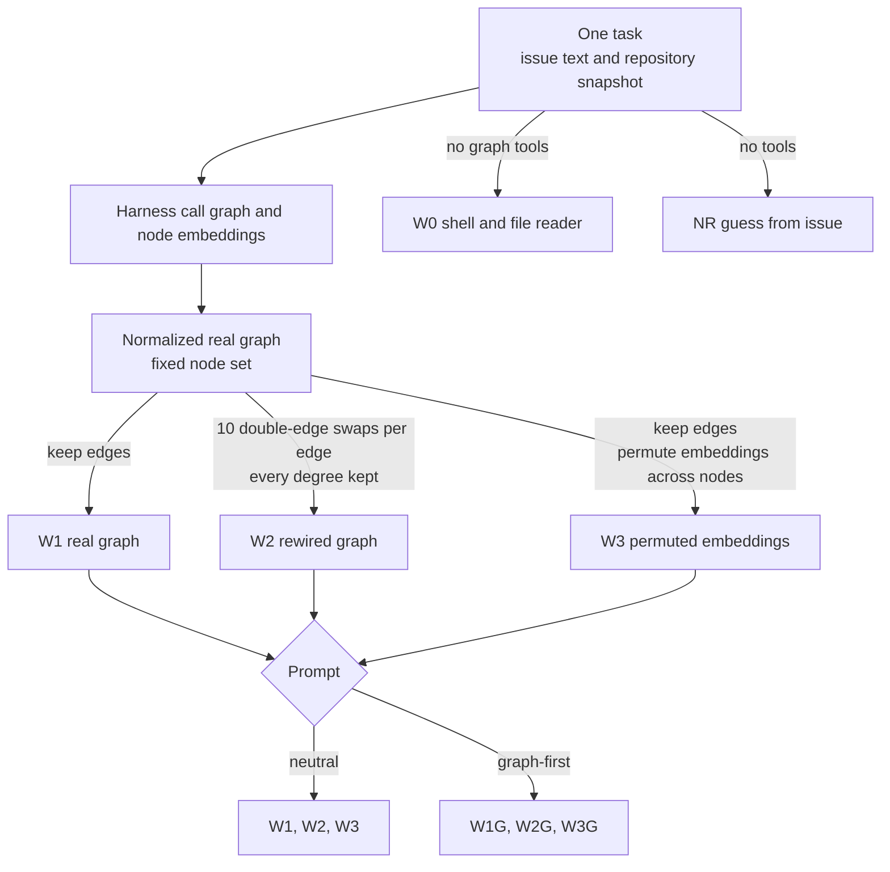
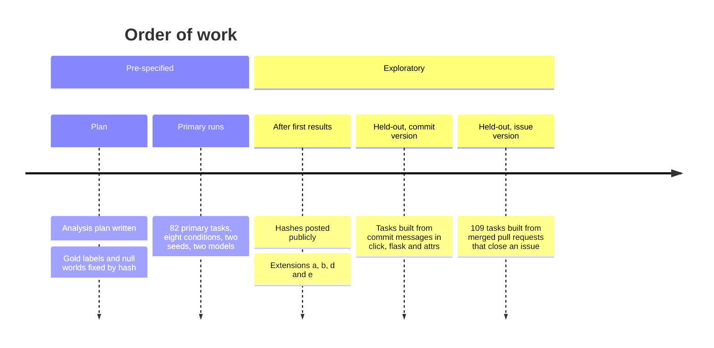
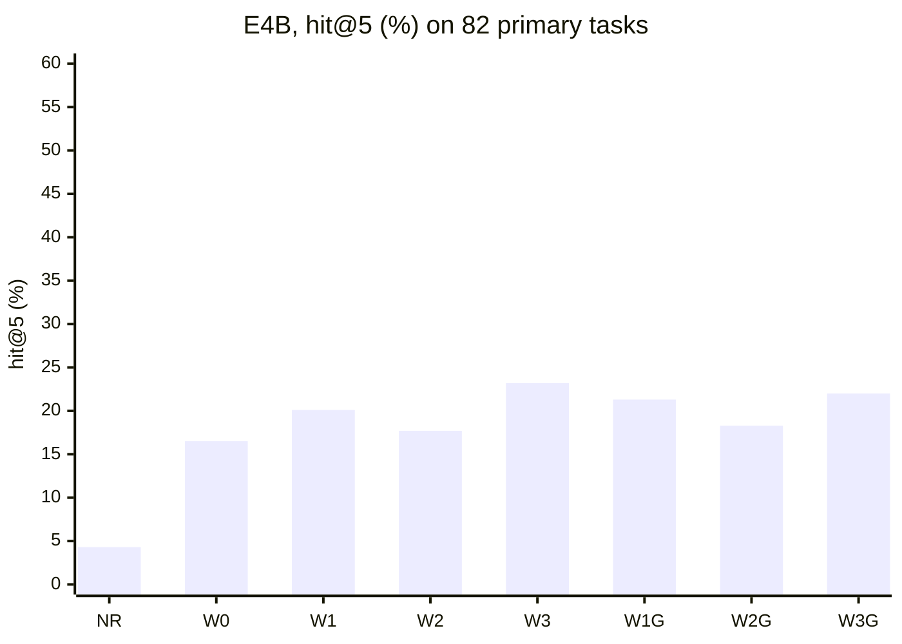
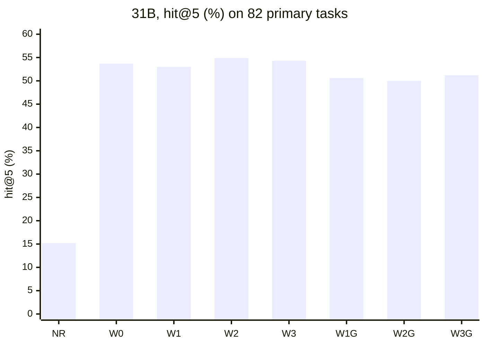
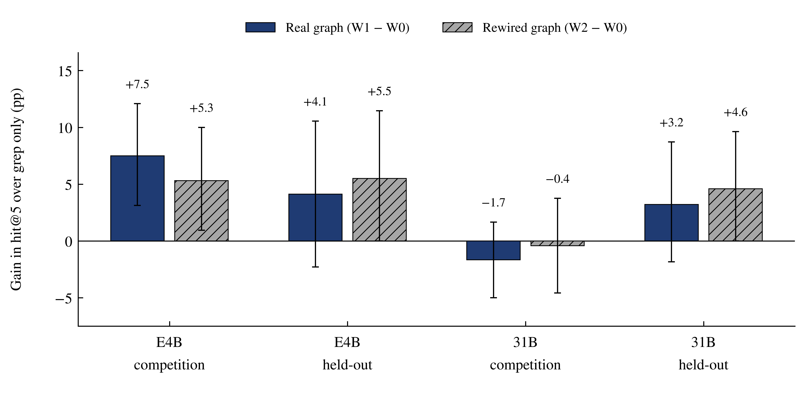
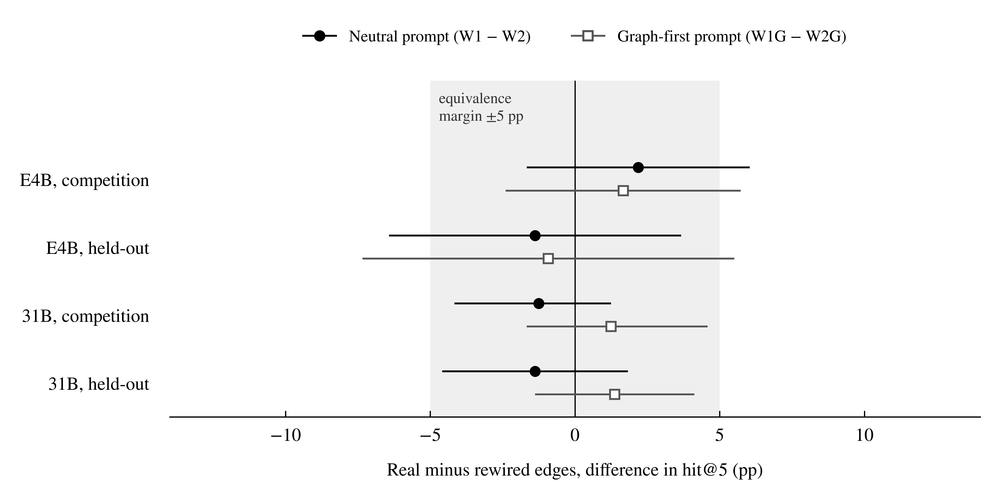
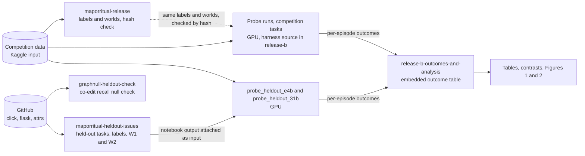

# Map or Ritual?

**Null-world tests of code-graph tools for Gemma 4 coding agents**

[](LICENSE)
[](https://www.python.org/)
[](https://www.kaggle.com/code/suchitayerramsetty/release-b-outcomes-and-analysis)
[](https://ai.google.dev/gemma)

This is the code release for a submission to the Kaggle Gemma 4 Developer Agent Paper Track. The submitted paper is [paper/paper.md](paper/paper.md) and the pre-specified analysis plan is [paper/analysis_plan_v1.md](paper/analysis_plan_v1.md). This README is meant to be read on its own. It covers the motivation, the method, every result with its interval, what did not work, and how to reproduce each number.

## TL;DR

Coding agents are given call graphs and embedding search on the premise that repository structure helps them find the code to change, but a with-and-without comparison cannot tell whether a gain comes from the structure or from having one more tool. We build interface-matched null worlds that keep the tools, the nodes and every node degree fixed and scramble only which functions are connected. Across two Gemma 4 models and 9,932 agent episodes, real and rewired graphs give the same localization accuracy for the 31B model within 5 points, on 120 competition tasks and on 109 issue tasks from three held-out repositories. The E4B model gains 7.5 points from graph tools over grep on competition tasks, but a graph with scrambled edges still delivers 5.3 of them, and on held-out issues it delivers all of the gain. The benefit is real, and it comes mostly from a name index, not from the map.

**Key results.** Paired differences in hit@5, percentage points (pp). Competition uses 120 tasks and all seeds, held-out uses 109 issue tasks. Full intervals are in [Table 2](#rq2-do-the-tools-help-and-is-it-the-edges). "eq" marks equivalence within 5 pp.

| Contrast | E4B competition | E4B held-out | 31B competition | 31B held-out |
|---|---|---|---|---|
| Real graph tools minus grep (W1-W0) | +7.5 | +4.1 | -1.7 eq | +3.2 |
| Rewired graph tools minus grep (W2-W0) | +5.3 | +5.5 | -0.4 eq | +4.6 |
| Real minus rewired, neutral prompt (W1-W2) | +2.2 | -1.4 | -1.2 eq | -1.4 eq |

## The question

Coding agents are now routinely handed a map of the repository, a call graph and an embedding index with tools to query both. The Gemma 4 Developer Agent harness ships three such tools beside the usual shell and file tools. Finding where to change code is often the hardest part of resolving an issue, and several systems report gains from graph-guided navigation.

What those gains measure is less clear. An agent with graph tools differs from one without in more than the information it receives. It has a longer tool list, a different prompt, a way to turn a bare name into a full symbol path, and extra turns to think. Removing the graph tools removes all of these at once. A comparison of "with graph" against "without graph" therefore cannot separate the map from the ritual of consulting it.

We separate them by changing only the content of the map. If success depends on the real structure, it should fall when the structure is scrambled and everything else is held fixed. Degree-preserving rewiring is a standard null model in network science, and randomization tests of this kind have exposed saliency methods that did not depend on the model they claimed to explain. We apply the same logic to agent tools.

## Null worlds

A world is a directory of graph and embedding files that the harness's own graph library loads. Graph worlds expose the same tool names, descriptions and output format, so the agent cannot tell them apart by interface.

| World | Tools | Graph content | Embeddings |
|---|---|---|---|
| NR | None | None | None |
| W0 | Read-only shell and file reader | None | None |
| W1 | W0 tools plus the three graph tools | Real call graph, normalized | Real |
| W2 | Same as W1 | Real graph after 10 double-edge swaps per edge, every node degree kept | Real |
| W3 | Same as W1 | Real call graph | Real vectors permuted across nodes |
| W1G, W2G, W3G | Same as W1, W2, W3 | Same as W1, W2, W3 | Same as W1, W2, W3 |

NR asks the model to guess from the issue alone. W1 to W3 run under a neutral prompt that lists the tools. The G variants run the same worlds under a graph-first prompt that tells the model to search by symbol and follow neighbours before reading files.

The rewire uses a fixed per-graph seed derived from seed 20261108. Every node keeps its degree in all 127 graphs, and a median of 97.9% of edges change.



## What stays fixed and what changes

A tool ablation compares W1 with W0. An interface-matched null compares W1 with W2 (edges) or W1 with W3 (embeddings).

| Property | Tool ablation (W1 vs W0) | Interface-matched null (W1 vs W2) |
|---|---|---|
| Tool names and descriptions | Differ | Same |
| Prompt | Differs | Same |
| Node set | Present vs absent | Same |
| Tool output format | Present vs absent | Same |
| Degree of every node | Present vs absent | Same |
| Search from a bare name to a full symbol path | Present vs absent | Same |
| Turns the agent can spend on graph calls | Present vs absent | Same |
| Which functions are connected | Real vs absent | Real vs scrambled |
| What a difference in accuracy measures | Interface and content together | Content only |

A gain in the left column can come from any row. A gain in the right column can come only from which functions are connected.

## Study design

### Data, labels and the probe agent

The development set has 129 issues from four Python repositories, each with a gold patch, a call graph and one 256-dimensional embedding per node. Graphs have a single edge type, calls, stored in both directions. A gold function is a graph node whose source contains the lines changed by a non-test hunk of the gold patch, taking the innermost match. This labels 120 tasks.

The primary set keeps a task only if no gold function name appears in the issue text, every gold hunk maps to a node, and the patch touches at most eight source files. This leaves 82 tasks. The other 38 form a secondary set. In 32 of them the issue names a gold function.

The probe agent receives the issue and returns up to five qualified function names. It uses native tool calling through the competition's vLLM configuration, with the harness's tool names and descriptions, a budget of 20 tool calls and temperature 0.7.

The outcome is hit@5, whether any prediction matches a gold function. Contrasts are paired by task, with 95% bootstrap intervals over 10,000 resamples of tasks. Two conditions are called equivalent ("eq") only if the 90% interval lies within 5 pp.

### Pre-specified study

Eight conditions (NR, W0, W1, W2, W3, W1G, W2G, W3G), two seeds, 82 primary tasks and two models (Gemma 4 E4B and 31B) give 2,624 episodes. The plan fixed four hypotheses.

| Hypothesis | Statement |
|---|---|
| H2 | W1G beats W2G (real edges help under the graph-first prompt) |
| H3 | The H2 gap is larger when the gold function is reachable in the graph from a symbol named in the issue |
| H4 | W1G compared with W3G (real embeddings) |
| H5 | H2 repeated under the neutral prompt (W1 compared with W2) |

The plan, labels and worlds are identified by hashes (see [Hashes](#hashes)). We did not publish the hashes before the runs, so the ordering cannot be verified independently. We call the study pre-specified, not pre-registered.

### Exploratory extensions

Everything below was run after the first results were seen and is labelled exploratory.

| Label | Extension |
|---|---|
| (a) | Six more seeds for E4B on W1, W2, W1G and W2G |
| (b) | The 38 secondary tasks under W0, W1, W2, W1G and W2G for both models |
| (c) | A held-out set from click, flask and attrs, which are not in the competition data |
| (d) | The official sample agent with E4B on the real bug-fixing task, real against rewired graph, 80 tasks |
| (e) | A review turn that replays each episode and asks the model to reconsider, with or without a list of the symbols its graph tools had returned |

For (c) we took merged pull requests that close a GitHub issue, used the issue title and body as the problem statement, and took gold functions from the pull request's diff, with the same filters as the primary set. This gives 109 tasks (click 40, flask 40, attrs 29). Graphs come from a simple static call-graph builder and embeddings are hashed identifier vectors, in files the harness library reads unchanged. An earlier version of this set used commit messages in place of issues. It is kept in the release and reported below.

### Order of work



## Results

### RQ1. Does graph content matter? The pre-specified study

**Table 1. hit@5 (%) on the 82 primary tasks, seeds 1 and 2.**

| Model | NR | W0 | W1 | W2 | W3 | W1G | W2G | W3G |
|---|---|---|---|---|---|---|---|---|
| E4B | 4.3 | 16.5 | 20.1 | 17.7 | 23.2 | 21.3 | 18.3 | 22.0 |
| 31B | 15.2 | 53.7 | 53.0 | 54.9 | 54.3 | 50.6 | 50.0 | 51.2 |





**Pre-specified contrasts (pp, 95% intervals).**

| Contrast | E4B | 31B |
|---|---|---|
| H2, W1G minus W2G | +3.0 [-4.3, 10.4] | +0.6 [-3.0, 4.9] eq |
| H4, W1G minus W3G | -0.6 [-6.7, 4.9] | -0.6 [-5.5, 4.3] eq |
| H5, W1 minus W2 | +2.4 [-3.0, 8.5] | -1.8 [-5.5, 1.8] eq |
| H3, reachability interaction | +3.2 [-11.8, 17.9] | -1.3 [-9.9, 6.2] |
| Grep over guessing, W0 minus NR | +12.2 [4.9, 20.1] | +38.4 [28.7, 48.2] |

Reading code is the large effect. No hypothesis about graph content is supported. For 31B the real graph is equivalent to the rewired graph under both prompts and to permuted embeddings. For E4B every interval includes zero and none is tight enough to claim equivalence.

**Adoption.** Share of episodes with at least one graph call.

| Model | Task set | W1 | W2 | W1G | W2G |
|---|---|---|---|---|---|
| E4B | Primary | 78.7% | 81.7% | 98.8% | 98.2% |
| E4B | Held-out | 75.2% | 74.3% | | |
| 31B | Primary | 22.0% | 20.1% | 92.7% | 92.7% |
| 31B | Held-out | 12.8% | 13.3% | | |

The two models treat the tools differently. E4B calls a graph tool in most episodes without being told to. 31B rarely does, and the graph-first prompt raises adoption without raising accuracy. In 45% of graph-first primary episodes 31B makes exactly one graph call and returns to grep.

### RQ2. Do the tools help, and is it the edges?

**Table 2. Paired differences in hit@5 (pp) with 95% intervals. Competition uses 120 tasks and all seeds. eq marks equivalence within 5 pp.**

| Contrast | Model | Competition | Held-out issues |
|---|---|---|---|
| Real tools minus grep (W1-W0) | E4B | +7.5 [3.1, 12.1] | +4.1 [-2.3, 10.6] |
| | 31B | -1.7 [-5.0, 1.7] eq | +3.2 [-1.8, 8.7] |
| Rewired tools minus grep (W2-W0) | E4B | +5.3 [0.9, 10.0] | +5.5 [0.0, 11.5] |
| | 31B | -0.4 [-4.6, 3.8] eq | +4.6 [0.0, 9.6] |
| Real minus rewired, neutral (W1-W2) | E4B | +2.2 [-1.7, 6.0] | -1.4 [-6.4, 3.7] |
| | 31B | -1.2 [-4.2, 1.2] eq | -1.4 [-4.6, 1.8] eq |
| Real minus rewired, graph-first (W1G-W2G) | E4B | +1.7 [-2.4, 5.7] | -0.9 [-7.3, 5.5] |
| | 31B | +1.2 [-1.7, 4.6] eq | +1.4 [-1.4, 4.1] eq |



*Figure 1. Gain in hit@5 over grep-only tools with the real graph and with the rewired graph, with 95% intervals.*

**The large model.** Across 229 tasks and both prompts, real and rewired graphs are equivalent for 31B. Under the neutral prompt it is not reliably better than grep alone. On held-out issues a graph-first instruction lifts 31B over grep by 12.4 pp [6.4, 18.8] with the real graph and by 11.0 pp [5.0, 17.0] with the rewired one. The gain follows the instruction and the tool, not the structure.

**The small model.** Graph tools help E4B, by 7.5 pp over grep on competition tasks. A graph whose edges are scrambled still gives 5.3 pp, so most of the benefit does not depend on the edges. It comes from having the tools, above all a search that turns a name from the issue into a full symbol path. The gain is largest on the 38 secondary tasks, 32 of which name a gold function in the issue (+14.5 pp [5.3, 25.0]). On held-out issues the real graph adds 4.1 pp over grep and the rewired graph 5.5 pp. Under the graph-first prompt on held-out issues, W1G adds +8.7 [2.3, 15.6] and W2G adds +9.6 [3.2, 16.1] over grep. In the first held-out version, built from commit messages, the rewired graph kept about half of a 13.3 pp gain (E4B W1-W0 +13.3 [8.3, 18.3], W2-W0 +7.1 [2.1, 12.1]).

**The edges themselves.** With eight seeds on the 82 primary tasks, E4B real minus rewired is +0.2 [-3.2, 3.4] under the neutral prompt, which is equivalent, and +3.0 [-0.6, 6.7] under the graph-first prompt. Averaged over the two prompts, a summary we did not plan, it is +1.9 [-1.0, 4.9] on competition tasks and -1.1 [-5.5, 3.2] on held-out issues, and both are equivalent within 5 pp. Edge content contributes at most a few points for E4B, and we cannot distinguish it from zero.



*Figure 2. Real minus rewired graph under the neutral and graph-first prompts. The band marks the 5 pp equivalence margin.*

### RQ3. Is the signal there, and does the agent use it?

| Check | Real | Rewired | Difference (pp) |
|---|---|---|---|
| Co-edit recall on 362 held-out commits | 25.0% | 2.7% | +22.3 [18.7, 25.9] |
| Graph surfaced a gold function, E4B, graph-first | 33% | 24% | +9.1 [1.8, 16.5] |
| Graph surfaced a gold function, 31B, graph-first | 24% | 18% | +6.7 [2.4, 11.6] |

The null is not empty. In held-out commits, the neighbour list of an edited function contains another function edited in the same commit far more often with real edges than with rewired ones, at identical list sizes. Under the graph-first prompt the real graph also surfaced a gold function more often for both models.

The signal is lost downstream. After a gold function appeared in a tool result, E4B went on to read or search for it in about 60% of cases, and 31B in 88 to 97%. 31B follows up reliably but finds the same functions with grep. A review turn that listed the returned symbols raised E4B accuracy over a plain reminder by +2.0 pp [0.8, 3.4] and did nothing for 31B (+0.4 [-0.1, 1.2]). The E4B gain was largest with the rewired graph, so it reflects name search and not call structure.

### RQ4. Do the conclusions survive the official agent and other labels?

**Official sample agent.** With E4B on real bug fixing over 80 tasks, 6 tasks were resolved with the real graph and 5 with the rewired graph (+1.2 pp [-2.5, 6.2]). The agent called similarity search 266 times and the edge tools 32 times. Resolution is near the floor, so this check can rule out only a large hidden benefit.

**Label audit.** An independent labeller that maps changed line numbers to AST spans in the task snapshot finds 161 primary gold nodes against 170 from text matching. The two agree on 130, which confirms 130 of the 170 (76.5%). Re-scoring every stored prediction with the AST labels, with only the nodes both methods agree on, or with their union leaves every RQ1 conclusion unchanged.

## What we got wrong or could not show

- **Pre-specified, not pre-registered.** The plan, labels and worlds were fixed by hash before the confirmatory runs, but the hashes were posted publicly only after the first results. Nobody outside the project can verify the ordering. The heading of [paper/analysis_plan_v1.md](paper/analysis_plan_v1.md) still calls it a pre-registration, which overstates it for this reason.
- **Most of the evidence is exploratory.** The pre-specified study covers 82 tasks from three repositories and two models of one family. The extra seeds, the secondary set, both held-out sets, the official agent and the review turn were all added after the first results.
- **The first held-out version used commit messages.** It used commit messages in place of issue text as the problem statement. We rebuilt the held-out set from GitHub issues and report the commit version only as context (the rewired graph kept about half of a 13.3 pp gain there).
- **E4B edge effects are not distinguishable from zero.** For E4B no real-minus-rewired interval excludes zero, and only some are tight enough to call equivalent. We can say edge content contributes at most a few points, not that it contributes nothing.
- **The official-agent check has little power.** With 6 and 5 resolved tasks out of 80, it can rule out only a large hidden benefit.
- **Labels disagree with an independent labeller on about a quarter of nodes.** Conclusions hold under all four label sets, but the disagreement is a real source of noise.
- **Deviations from the plan.** The planned mixed-effects model was replaced by a GEE with task clusters, which gives odds ratios for real against rewired edges of 1.17 [0.80, 1.71] for E4B and 0.93 [0.80, 1.07] for 31B. The plan named a Holm correction across H2, H3 and H4. The paper applies no correction for multiple comparisons.
- **Other limits.** Localization is a proxy for bug fixing. The probe agent is our own. Held-out tasks use our own call-graph builder and lexical embeddings, with two seeds per model. Secondary tasks were excluded from the primary set by rule and 20 of them served as pilots. The 31B primary episodes span three sessions with identical code and seeds.

## Reproduce

### Public Kaggle notebooks

| Notebook | Source in this repository | Needs |
|---|---|---|
| [maporritual-release](https://www.kaggle.com/code/suchitayerramsetty/maporritual-release) | [graphnull/release_a_labels_and_worlds.py](graphnull/release_a_labels_and_worlds.py) | CPU, competition data as input |
| [release-b-outcomes-and-analysis](https://www.kaggle.com/code/suchitayerramsetty/release-b-outcomes-and-analysis) | [analysis/release_b_outcomes_and_analysis.ipynb](analysis/release_b_outcomes_and_analysis.ipynb) | CPU only, no input, no internet |
| [graphnull-heldout-check](https://www.kaggle.com/code/suchitayerramsetty/graphnull-heldout-check) | [heldout/null_check_coedit_recall.py](heldout/null_check_coedit_recall.py) | CPU, internet on, no competition data |
| [maporritual-heldout-issues](https://www.kaggle.com/code/suchitayerramsetty/maporritual-heldout-issues) | [heldout/build_issue_tasks.py](heldout/build_issue_tasks.py) | CPU, internet on, Kaggle secret `GITHUB_TOKEN` |

The held-out builder reads a Kaggle secret named `GITHUB_TOKEN` (read-only public access is enough) and never prints it. If the secret is missing it stops with a message naming the secret.

The probe runs need GPUs and the official vLLM setup, so they are not among the public notebooks. The held-out probe notebooks are [probe/probe_heldout_e4b.ipynb](probe/probe_heldout_e4b.ipynb) and [probe/probe_heldout_31b.ipynb](probe/probe_heldout_31b.ipynb). The probe harness used on the competition tasks ships as source inside the release-b notebook, which writes it to `probe_harness.py` for reading and does not execute it.



### Where each number comes from

"Printed" means the notebook prints the number. "MORE NUMBERS" is the release-b cell that prints the numbers outside the main tables.

| Paper number | Where | Status |
|---|---|---|
| Rewire invariants (degrees kept in all 127 graphs, median 97.9% of edges changed) | maporritual-release | Printed |
| Label and world hashes | maporritual-release | Printed and checked |
| Episode count 9,932 and outcome table hash | release-b-outcomes-and-analysis, data cell | Printed and checked |
| Table 1 | release-b-outcomes-and-analysis | Printed |
| H2, H4, H5 and grep over guessing | release-b-outcomes-and-analysis | Printed |
| Table 2 | release-b-outcomes-and-analysis | Printed |
| E4B eight-seed contrasts | release-b-outcomes-and-analysis | Printed |
| Adoption shares | release-b-outcomes-and-analysis | Printed |
| Review turn | release-b-outcomes-and-analysis | Printed |
| Official agent resolved counts | release-b-outcomes-and-analysis | Printed |
| Figures 1 and 2 | release-b-outcomes-and-analysis | Redrawn |
| H3 reachability interaction | release-b-outcomes-and-analysis, MORE NUMBERS | Printed |
| Secondary tasks, E4B real tools minus grep (+14.5) | release-b-outcomes-and-analysis, MORE NUMBERS | Printed |
| Graph surfaced a gold function, and follow-up rates | release-b-outcomes-and-analysis, MORE NUMBERS | Printed |
| Label audit counts and re-scoring under the AST, both and union label sets | release-b-outcomes-and-analysis, MORE NUMBERS | Printed |
| GEE odds ratios | release-b-outcomes-and-analysis, MORE NUMBERS | Printed |
| Held-out graph-first over grep | release-b-outcomes-and-analysis, MORE NUMBERS | Printed |
| Averages over both prompts | release-b-outcomes-and-analysis, MORE NUMBERS | Printed |
| Commit-version held-out gains | release-b-outcomes-and-analysis, MORE NUMBERS | Printed |
| 31B single graph call share (45%) | release-b-outcomes-and-analysis, MORE NUMBERS | Printed |
| Official agent interval and tool-call counts | release-b-outcomes-and-analysis, MORE NUMBERS | Printed |
| Co-edit recall null check (25.0% vs 2.7%) | graphnull-heldout-check | Printed |
| Held-out task and label hashes | maporritual-heldout-issues | Printed |

The GEE cell imports `statsmodels`, which the default Kaggle Python image provides. Raw traces are not published because tool outputs quote competition source files. The mechanism and label-audit numbers are recomputed from derived per-episode scores instead (see [Data policy](#data-policy)).

### Steps

1. Run maporritual-release with the competition "Gemma 4 Developer Agent" attached as input. Its hash check prints `MATCH` for both the labels and the worlds against the hashes in the plan.
2. Run release-b-outcomes-and-analysis. It needs no input and recomputes the numbers marked "Printed" above from the embedded tables.
3. Run graphnull-heldout-check with internet on. It clones click, flask and attrs at pinned commits.
4. Run maporritual-heldout-issues with internet on and the `GITHUB_TOKEN` secret attached.
5. To rerun the held-out probe, attach the competition data, the Gemma 4 models and the output of step 4 to the probe notebooks and run them on GPU.

Seeds are fixed throughout. The rewire and the held-out builders use seed 20261108.

## Repository layout

```
map-or-ritual/
├── LICENSE                                      # Apache License 2.0
├── README.md
├── analysis/
│   ├── card.py                                  # draws the submission card image
│   └── release_b_outcomes_and_analysis.ipynb    # outcome table, every printed number, figures
├── graphnull/
│   └── release_a_labels_and_worlds.py           # gold labels, W1/W2/W3 worlds, hash check
├── heldout/
│   ├── build_commit_tasks_v1.py                 # first held-out version, from commit messages
│   ├── build_issue_tasks.py                     # held-out issue tasks (reads GITHUB_TOKEN)
│   └── null_check_coedit_recall.py              # co-edit recall, real vs rewired
├── paper/
│   ├── analysis_plan_v1.md                      # pre-specified analysis plan
│   ├── paper.md                                 # submitted paper
│   └── figures/
│       ├── fig1_gain_over_grep.pdf
│       ├── fig1_gain_over_grep.png
│       ├── fig2_real_minus_rewired.pdf
│       └── fig2_real_minus_rewired.png
└── probe/
    ├── probe_heldout_31b.ipynb                  # held-out probe runs, Gemma 4 31B
    └── probe_heldout_e4b.ipynb                  # held-out probe runs, Gemma 4 E4B
```

## Data policy

No competition data is in this repository or in any public notebook output. The labels-and-worlds notebook writes everything to `/tmp` and prints only counts and hashes.

The release-b notebook embeds two tables. The outcome table holds one row per episode with model, task set, task id, condition, seed, scores, tool-call counts and status. A second table holds derived per-episode scores for the primary study. These are a reachability flag, whether a graph tool surfaced a gold function, whether the agent followed it up, and hit@5 under the audit label sets. The notebook also stores a task category per task id and per-task counts of gold nodes. None of these tables holds gold labels, source code, task text or tool output. Raw traces are withheld because tool outputs quote competition source files. The held-out builders read only public GitHub repositories.

## Hashes

sha256 prefixes.

| Item | Hash |
|---|---|
| Analysis plan ([paper/analysis_plan_v1.md](paper/analysis_plan_v1.md)) | `cf0715bb36046f6e` |
| Primary gold labels | `a0ceb7ebce446eec` |
| Null worlds manifest | `5b88c0e967618d8b` |
| Held-out issue tasks | `3b23bb85b67e6a5f` |
| Held-out issue labels | `2bec9d75ed40af98` |
| Outcome table | `00a9ba201be06f31` |

## Citation

```bibtex
@misc{maporritual2026,
  title        = {Map or Ritual? Null-World Tests of Code-Graph Tools for Gemma 4 Coding Agents},
  author       = {TODO fill in author names},
  year         = {2026},
  howpublished = {Kaggle Gemma 4 Developer Agent Paper Track},
  note         = {Code release, https://www.kaggle.com/code/suchitayerramsetty/release-b-outcomes-and-analysis}
}
```

## License

Apache License 2.0. The full text is in [LICENSE](LICENSE).
