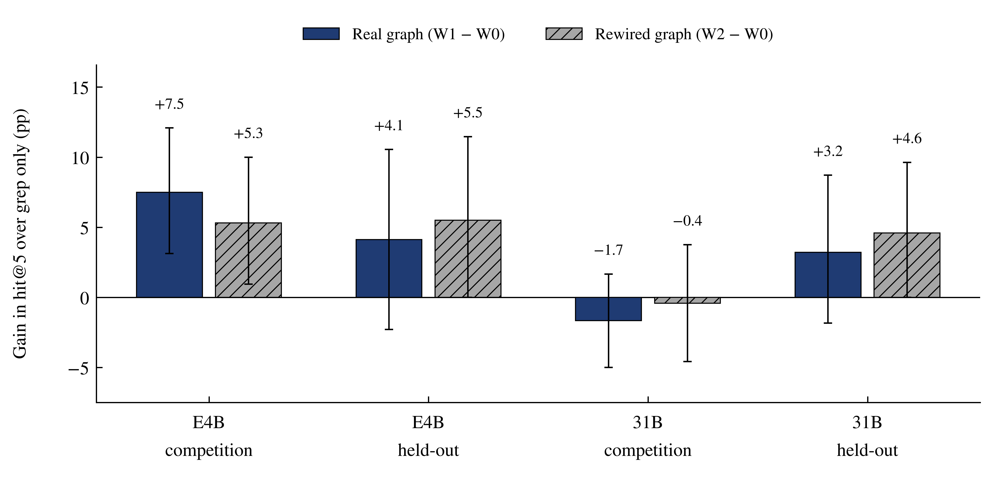
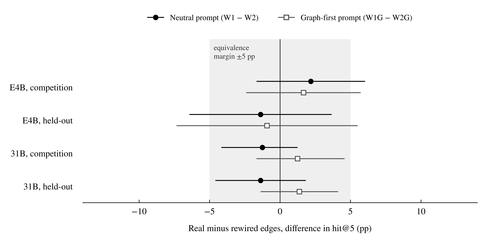

## Abstract

Coding agents are given call graphs and embedding search on the premise that repository structure helps them find the code to change. A with-and-without comparison cannot tell whether a gain comes from the structure or from having one more tool. We separate the two with interface-matched null worlds. For each task we keep the tools, the nodes and every node degree fixed, and scramble only which functions are connected. On the Gemma 4 Developer Agent data, with two Gemma 4 models and 9,932 agent episodes, real and rewired graphs give the same localization accuracy for the 31B model within 5 points, on 120 competition tasks and on 109 issue tasks from three held-out repositories. The 31B model calls a graph tool in at most a fifth of episodes and loses nothing by it. The E4B model gains 7.5 points from graph tools over grep on competition tasks, but a graph with scrambled edges still delivers 5.3 of them, and on held-out issues it delivers all of the gain. The benefit is real, and it comes mostly from a name index, not from the map. We release the null-world generator, the outcome table and a notebook that recomputes every number.

## 1 Introduction

Coding agents are now routinely handed a map of the repository, a call graph and an embedding index with tools to query both. The Gemma 4 Developer Agent harness ships three such tools beside the usual shell and file tools [12]. The premise is reasonable. Finding where to change code is often the hardest part of resolving an issue [1, 2], and several systems report gains from graph-guided navigation [3, 4, 5, 14, 15].

What those gains measure is less clear. An agent with graph tools differs from one without in more than the information it receives. It has a longer tool list, a different prompt, a way to turn a bare name into a full symbol path, and extra turns to think. A comparison of "with graph" against "without graph" cannot separate the map from the ritual of consulting it.

We separate them by changing only the content of the map. For every task we build null worlds that keep the tool interface, the node set, the output format and every node's degree exactly as in the real graph, and change only which nodes are connected or which embedding belongs to which node. If success depends on the real structure it should fall when the structure is scrambled.

We contribute GraphNull, a deterministic generator of interface-matched null worlds for any graph in the harness format; a pre-specified experiment on two Gemma 4 sizes with labelled extensions to more seeds, tasks, held-out repositories and the official agent; and a decomposition of the tool benefit into the part that needs real edges and the part that does not.

## 2 Related work

**Graphs for code agents.** SWE-bench [1] made issue resolution the standard test for coding agents, and SWE-agent [11] and Agentless [2] showed that localization drives much of the outcome. RepoGraph [3], CodexGraph [5], LocAgent [4], OrcaLoca [14] and CoSIL [15] give agents repository graphs and report better localization and resolution. Their evidence is a comparison of systems with and without the graph component.

**Is structure needed?** GrepRAG [7] finds that grep-style retrieval matches or beats graph retrieval for code completion, and Sen et al. [16] reach a similar verdict for agent memory. Bhola et al. [8] toggle a structural index inside one harness with a large proprietary model and find it helps on multi-file changes. Closest to us, Bellam [6] ablates tool sets for ten small open models, Gemma 4 E4B among them, on SWE-bench Verified. That study finds that structured tools help small models most, that agents rarely chain graph expansions, and that part of the gain reflects the form of the answer more than finding the target. Our results agree on all three points. Our method differs. A tool ablation removes the interface together with the content. We keep the interface and remove only the content, which is the step needed to attribute a gain to structure.

**Graphs for language models.** The same question arises for knowledge graphs. Tree-of-Traversals [17] gives a black-box model actions for walking a graph, as the harness tools do for code. KG-LLM-Bench [18] shows that the way a graph is presented changes accuracy with the facts held fixed, an interface effect of the kind we isolate. Models also stay useful when graph facts are corrupted [19, 20].

**Null models.** Degree-preserving rewiring comes from network science [9], and randomization tests exposed saliency methods that did not depend on the model they claimed to explain [10]. We bring the same logic to agent tools.

## 3 Method

**Data and labels.** The development set has 129 issues from four Python repositories, each with a gold patch, a call graph and one 256-dimensional embedding per node. Graphs have a single edge type, calls, stored in both directions. A gold function is a graph node whose source contains the lines changed by a non-test hunk of the gold patch, taking the innermost match. This labels 120 tasks. The primary set keeps a task only if no gold function name appears in the issue text, every gold hunk maps to a node, and the patch touches at most eight source files. This leaves 82 tasks. The other 38 form a secondary set. In 32 of them the issue names a gold function.

**Null worlds.** Each world is a directory of graph and embedding files that the harness's own graph library loads, so worlds cannot be told apart by interface. W1 is the real graph, normalized. W2 applies ten double-edge swaps per edge with a fixed per-graph seed. Every node keeps its degree in all 127 graphs and a median of 97.9% of edges change. W3 keeps the real graph and permutes embedding vectors across nodes. W0 offers only a read-only shell and a file reader. NR offers no tools and asks the model to guess from the issue alone.

**Probe agent.** The agent receives the issue and returns up to five qualified function names. It uses native tool calling through the competition's vLLM configuration, with the harness's tool names and descriptions and a budget of 20 tool calls. Graph worlds run under a neutral prompt that lists the tools and under a graph-first prompt, marked G, that tells the model to search by symbol and follow neighbours before reading files. Temperature is 0.7.

**Outcome and analysis.** The outcome is hit@5, whether any prediction matches a gold function. Contrasts are paired by task, with 95% bootstrap intervals over 10,000 resamples of tasks. We call two conditions equivalent only if the 90% interval lies within 5 percentage points (pp).

**Pre-specified study.** Eight conditions (NR, W0, W1, W2, W3, W1G, W2G, W3G), two seeds, 82 primary tasks and two models (E4B and 31B) give 2,624 episodes. The plan fixed four hypotheses. H2 says W1G beats W2G. H3 says that gap is larger when the gold function is reachable in the graph from a symbol named in the issue. H4 compares W1G with W3G. H5 repeats H2 under the neutral prompt. The plan, labels and worlds are identified by hashes. We did not publish the hashes before the runs, so the ordering cannot be verified independently and we call the study pre-specified, not pre-registered.

**Extensions, run after the first results and labelled exploratory.** (a) Six more seeds for E4B on W1, W2, W1G and W2G. (b) The secondary set under W0, W1, W2, W1G and W2G for both models. (c) A held-out set from click, flask and attrs, which are not in the competition data. We took merged pull requests that close a GitHub issue, used the issue title and body as the problem statement, and took gold functions from the pull request's diff, with the same filters as the primary set. This gives 109 tasks. Graphs come from a simple static call-graph builder and embeddings are hashed identifier vectors, in files the harness library reads unchanged. An earlier version of this set used commit messages in place of issues, and we report it in the release. (d) The official sample agent with E4B on the real bug-fixing task, real against rewired graph, 80 tasks. (e) A review turn that replays each episode and asks the model to reconsider, with or without a list of the symbols its graph tools had returned.

## 4 Results

### 4.1 RQ1. Does graph content matter? The pre-specified study

**Table 1. hit@5 (%) on the 82 primary tasks.**

|Model|NR|W0|W1|W2|W3|W1G|W2G|W3G|
|---|---|---|---|---|---|---|---|---|
|E4B|4.3|16.5|20.1|17.7|23.2|21.3|18.3|22.0|
|31B|15.2|53.7|53.0|54.9|54.3|50.6|50.0|51.2|

Reading code is the large effect. Grep and file reading add 12.2 pp for E4B [4.9, 20.1] and 38.4 pp for 31B [28.7, 48.2] over guessing. No hypothesis about graph content is supported. For 31B the real graph is equivalent to the rewired graph under both prompts (H2 +0.6 [-3.0, 4.9], H5 -1.8 [-5.5, 1.8]) and to permuted embeddings (H4 -0.6 [-5.5, 4.3]). For E4B every interval includes zero and none is tight enough for equivalence (H2 +3.0 [-4.3, 10.4], H5 +2.4 [-3.0, 8.5], H4 -0.6 [-6.7, 4.9]). The reachability interaction H3 is +3.2 [-11.8, 17.9] for E4B and -1.3 [-9.9, 6.2] for 31B.

The models treat the tools differently. Under the neutral prompt E4B calls a graph tool in 79.5% of episodes and 31B in 20.3%. The graph-first prompt raises this to 98.8% and 92.7% without raising accuracy. In 45% of graph-first episodes 31B makes exactly one graph call and returns to grep.

### 4.2 RQ2. Do the tools help, and is it the edges?

**Table 2. Paired differences in hit@5 (pp) with 95% intervals. Competition uses 120 tasks and all seeds. eq marks equivalence within 5 pp.**

|Contrast|Model|Competition|Held-out issues|
|---|---|---|---|
|Real tools minus grep (W1-W0)|E4B|+7.5 [3.1, 12.1]|+4.1 [-2.3, 10.6]|
||31B|-1.7 [-5.0, 1.7] eq|+3.2 [-1.8, 8.7]|
|Rewired tools minus grep (W2-W0)|E4B|+5.3 [0.9, 10.0]|+5.5 [0.0, 11.5]|
||31B|-0.4 [-4.6, 3.8] eq|+4.6 [0.0, 9.6]|
|Real minus rewired, neutral (W1-W2)|E4B|+2.2 [-1.7, 6.0]|-1.4 [-6.4, 3.7]|
||31B|-1.2 [-4.2, 1.2] eq|-1.4 [-4.6, 1.8] eq|
|Real minus rewired, graph-first (W1G-W2G)|E4B|+1.7 [-2.4, 5.7]|-0.9 [-7.3, 5.5]|
||31B|+1.2 [-1.7, 4.6] eq|+1.4 [-1.4, 4.1] eq|

**Figure 1. Gain in hit@5 over grep-only tools with the real graph and with the rewired graph, with 95% intervals.**

**The large model.** Across 229 tasks and both prompts, real and rewired graphs are equivalent for 31B. Under the neutral prompt it uses graph tools in 22% of primary and 13% of held-out episodes and is not reliably better than grep alone. On held-out issues a graph-first instruction lifts 31B by 12.4 pp over grep [6.4, 18.8] with the real graph and by 11.0 pp [5.0, 17.0] with the rewired one. The gain follows the instruction and the tool, not the structure.

**The small model.** Graph tools help E4B. The gain over grep is 7.5 pp on the competition tasks. A graph whose edges are scrambled still gives 5.3 pp, so most of the benefit does not depend on the edges. It comes from having the tools, above all a search that turns a name from the issue into a full symbol path. The gain is largest on the 38 secondary tasks, 32 of which name a gold function in the issue (+14.5 pp [5.3, 25.0]). On 109 held-out issues the real graph adds 4.1 pp over grep and the rewired graph 5.5 pp, so there the scrambled graph keeps all of the benefit. Under the graph-first prompt both add about 9 pp (+8.7 [2.3, 15.6] and +9.6 [3.2, 16.1]). In the first held-out version, built from commit messages, the rewired graph kept about half of a 13.3 pp gain.

**The edges themselves.** The remaining real-minus-rewired difference for E4B is small. With eight seeds on the primary tasks it is +0.2 [-3.2, 3.4] under the neutral prompt, which is equivalent, and +3.0 [-0.6, 6.7] under the graph-first prompt. On held-out issues it is -1.4 [-6.4, 3.7] and -0.9 [-7.3, 5.5]. Averaged over the two prompts, a summary we did not plan, it is +1.9 [-1.0, 4.9] on competition tasks and -1.1 [-5.5, 3.2] on held-out issues, and both are equivalent within 5 pp. Edge content contributes at most a few points for E4B, and we cannot distinguish it from zero.

**Figure 2. Real minus rewired graph under the neutral and graph-first prompts. The band marks the 5 pp equivalence margin.**

### 4.3 RQ3. Is the signal there, and does the agent use it?

The null is not empty. On 362 commits from the three held-out repositories, the neighbour list of an edited function contains another function edited in the same commit 25.0% of the time with real edges and 2.7% with rewired edges, at identical list sizes (+22.3 pp [18.7, 25.9]). Under the graph-first prompt the real graph surfaced a gold function more often, 33% against 24% of E4B episodes (+9.1 pp [1.8, 16.5]) and 24% against 18% for 31B (+6.7 pp [2.4, 11.6]).

The signal is lost downstream. After a gold function appeared in a tool result, E4B went on to read or search for it in about 60% of cases, and 31B in 88 to 97%. 31B follows up reliably but finds the same functions with grep. A review turn that listed the returned symbols raised E4B accuracy by 2.0 pp over a plain reminder [0.8, 3.4] and did nothing for 31B (+0.4 [-0.1, 1.2]). The E4B gain was largest with the rewired graph, so it reflects name search and not call structure.

### 4.4 RQ4. Do the conclusions survive the official agent and other labels?

With the official sample agent and E4B on real bug fixing, 6 of 80 tasks were resolved with the real graph and 5 with the rewired graph (+1.2 pp [-2.5, 6.2]). It called similarity search 266 times and the edge tools 32 times. Resolution is near the floor, so this check can rule out only a large hidden benefit.

We audited the labels with an independent labeller that maps changed line numbers to AST spans in the task snapshot. It confirms 130 of 170 primary gold nodes (76.5%). Re-scoring every stored prediction with the AST labels, with only the nodes both methods agree on, or with their union leaves every conclusion in Section 4.1 unchanged.

## 5 Discussion

The title asks whether the graph is a map or a ritual. For the 31B model it is a ritual. The model rarely consults the graph unless told to and performs the same with correct or scrambled edges. Where an instruction to use the graph helps, as on held-out issues, scrambled edges help just as much. For the E4B model the tools are useful, but mostly as an index. A scrambled graph keeps most of the benefit, and the part that depends on real edges is too small and too unstable for us to measure.

This matters for how tool gains are reported. An ablation on our competition tasks would credit the graph with 7.5 points for E4B. The null world shows that 5.3 of those points arrive with meaningless edges. On held-out issues the rewired graph gives slightly more than the real one. We recommend an interface-matched null whenever a structured tool is credited with an improvement. GraphNull makes this a few minutes of CPU work for any graph in the harness format.

For builders, edge quality is unlikely to pay for these models on these tasks. Name resolution and helping a small model act on candidates it has already seen look more promising.

## 6 Limitations

The pre-specified study covers 82 tasks from three repositories and two models of one family. Everything in Sections 4.2 to 4.4 was added after seeing its results and is exploratory. No correction for multiple comparisons is applied. Localization is a proxy for bug fixing. The probe agent is our own, and the official-agent check has little power. Held-out tasks use our own call-graph builder and lexical embeddings, with two seeds per model. Secondary tasks were excluded from the primary set by rule and 20 served as pilots. Our text-matching labels disagree with an independent labeller on about a quarter of nodes, although conclusions hold under all four label sets. The 31B primary episodes span three sessions with identical code and seeds. Hashes were posted publicly only after the first results [13]. The planned mixed-effects model was replaced by a GEE with task clusters, which gives odds ratios for real against rewired edges of 1.17 [0.80, 1.71] for E4B and 0.93 [0.80, 1.07] for 31B.

## References

[1] C. E. Jimenez et al. SWE-bench. ICLR 2024.
[2] C. S. Xia et al. Agentless. arXiv:2407.01489, 2024.
[3] S. Ouyang et al. RepoGraph. ICLR 2025.
[4] Z. Chen et al. LocAgent. ACL 2025.
[5] X. Liu et al. CodexGraph. NAACL 2025.
[6] S. Bellam. How Do Small Coding Agents Use Code Graphs and Embeddings? arXiv:2610.33958, 2026.
[7] B. Wang et al. GrepRAG. arXiv:2601.23254, 2026.
[8] I. Bhola et al. Code Isn't Memory. arXiv:2606.22417, 2026.
[9] S. Maslov, K. Sneppen. Specificity and Stability in Topology of Protein Networks. Science, 2002.
[10] J. Adebayo et al. Sanity Checks for Saliency Maps. NeurIPS 2018.
[11] J. Yang et al. SWE-agent. NeurIPS 2024.
[12] Google. The Gemma 4 Developer Agent Competition. Kaggle, 2026.
[13] Analysis plan hashes. kaggle.com/competitions/gemma-4-developer-agent-paper/discussion/758077
[14] Z. Yu et al. OrcaLoca. ICML 2025.
[15] Z. Jiang et al. CoSIL. ASE 2025.
[16] Sen et al. Is Grep All You Need? arXiv, 2026.
[17] E. Markowitz et al. Tree-of-Traversals. ACL 2024.
[18] E. Markowitz et al. KG-LLM-Bench. arXiv:2504.07087, 2025.
[19] Y. Sui et al. Can Knowledge Graphs Make Large Language Models More Trustworthy? ACL 2025.
[20] X. Dai et al. Large Language Models Can Better Understand Knowledge Graphs Than We Thought. arXiv:2402.11541, 2024.
